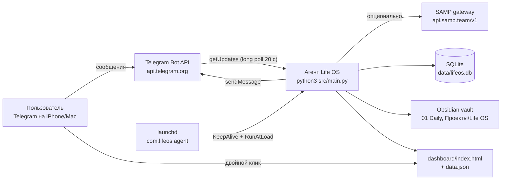
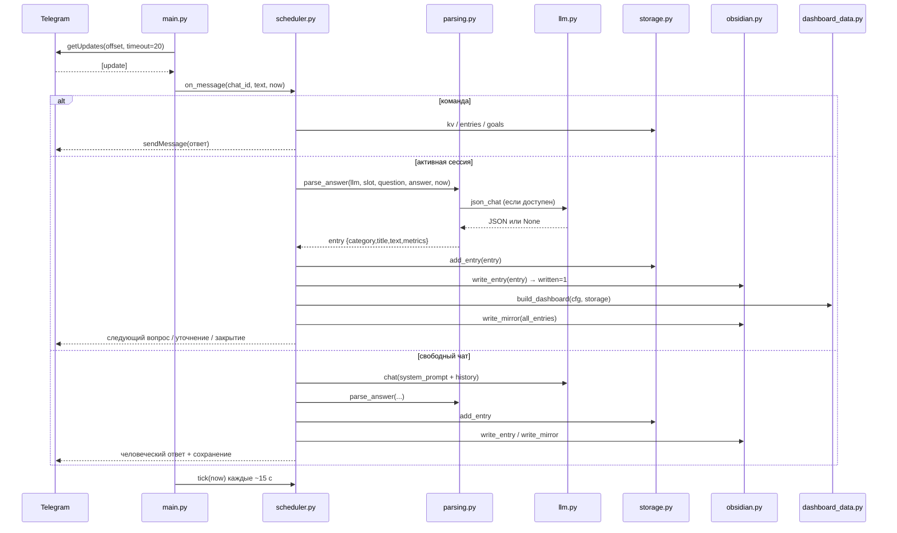
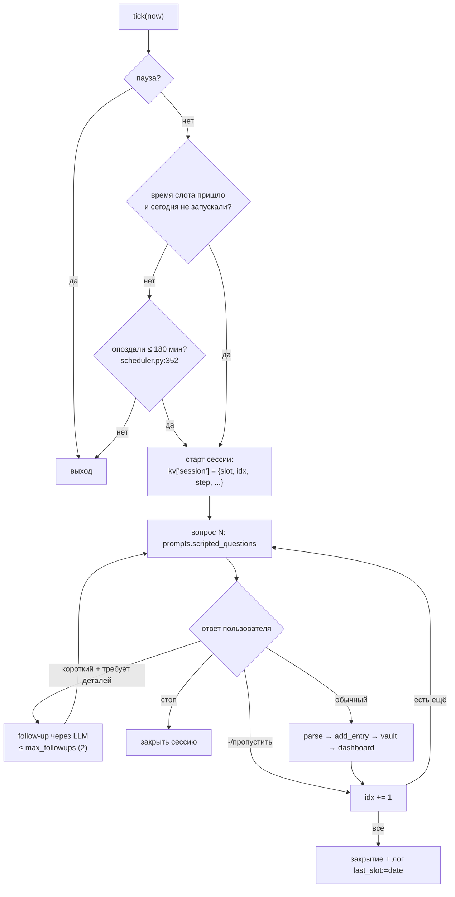
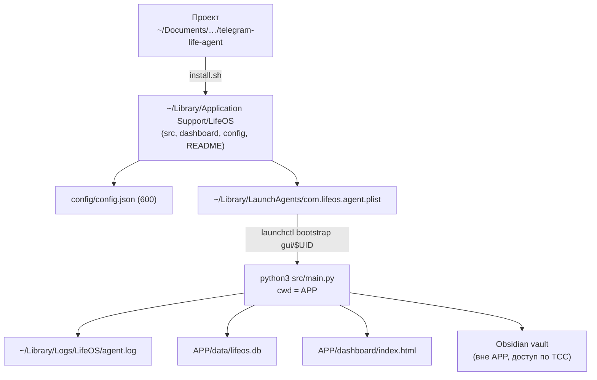

# ARCHITECTURE_MAP — Life OS

**Дата:** 2026-11-16 · **Стек:** Python 3.9+ stdlib, SQLite, Telegram Bot API, Obsidian Markdown,
self-contained HTML. **Один процесс, один поток, один цикл.**

---

## 1. Контекст системы

Внешние зависимости: Telegram (обязательно), SAMP (опционально). Всё остальное — локально.

## 2. Модули

| Файл | Строк | Владелец | Контракт | Роль |
|---|--:|---|---|---|
| `src/__init__.py` | 11 | Lead | — | пакет, `__version__ = "1.0.0"` (:11) |
| `src/config.py` | 286 | bot-core | §1 | поиск/слияние/валидация конфига, `resolve_path`, `project_root` |
| `src/telegram.py` | 235 | bot-core | §2 | Bot API на urllib: `call/send/get_updates`, split 4000, `TelegramError` |
| `src/storage.py` | 397 | bot-core | §3 | SQLite: messages, entries, goals, habits, kv; WAL, `busy_timeout` |
| `src/scheduler.py` | 1320 | bot-core | §8 | слоты, сессии, команды, свободный чат, запись в vault/dashboard, `write_mirror` |
| `src/llm.py` | 360 | brain | §4 | OpenAI-совместимый клиент SAMP, `User-Agent`, 429-retry, «никогда не бросает» |
| `src/prompts.py` | 471 | brain | §5 | личность, приветствия, вопросы по слотам, follow-up, JSON-разбор, `weekly_prompt` |
| `src/parsing.py` | 700 | brain | §6 | ответ → entry: LLM-JSON или эвристика; `heuristic_metrics` |
| `src/obsidian.py` | 1048 | vault | §7 | daily из шаблона, маркеры, цели между маркерами, mirror, `sync_pending` |
| `src/dashboard_data.py` | 927 | dash | §9 | `collect_data` + `build_dashboard`, вставка JSON в шаблон |
| `src/main.py` | 466 | bot-core | §10 | CLI, цикл, pid-лок, логи, SIGTERM |
| `src/mock_telegram.py` | 495 | qa | §11 | мок Bot API для тестов и e2e |
| `dashboard/template.html` | 701 | Lead | — | дизайн, CSS-токены, SVG-графики, `window.LIFEOS_DATA` (:275) |
| `install.sh` / `uninstall.sh` | 739 / 229 | ops | — | установка, launchd, права, подхват ключа |
| `ops/com.lifeos.agent.plist` | 37 | ops | — | LaunchAgent: RunAtLoad, KeepAlive, WorkingDirectory |

Запуск: `python3 src/main.py` из корня (main.py добавляет `project_root` в `sys.path`);
альтернативно `python3 -m src.main`. Импорты — `from src import …`.

## 3. Поток входящего сообщения

## 4. Поток слота (утро/день/вечер)

Состояние сессии переживает рестарт: лежит в `kv["session"]`, TTL 12 ч
(`src/scheduler.py:510`), просроченная сессия снимается на следующем тике.

## 5. Данные

| Хранилище | Путь | Содержимое | Права |
|---|---|---|---|
| SQLite | `data/lifeos.db` (прод: `~/Library/Application Support/LifeOS/data/lifeos.db`) | `messages`, `entries` (с `metrics` JSON и `written`), `goals`, `habits`, `kv` | 600 (каталог пользователя) |
| Дневник | `<vault>/01 Daily/YYYY-MM-DD.md` | разделы `## Еда (агент)`, `## Тренировка (агент)`, `## Задачи (агент)`, `## Цели (агент)`, `## Мысли (агент)`, `## Тело (агент)`; маркеры `<!-- lifeos:entry:ID -->` | наследует vault |
| Цели | `<vault>/Проекты/Life OS/Цели.md` | таблица между `<!-- lifeos:goals:start -->` / `end` | наследует vault |
| Зеркало | `<vault>/Life OS/data/entries.jsonl`, `goals.json` | все записи и цели в машинном виде (для Dataview/скриптов) | наследует vault |
| Дашборд | `dashboard/index.html` + `data.json` | HTML с встроенным `window.LIFEOS_DATA` и копия данных | 644 |
| Логи | `data/logs/agent.log` (handler, 5 МБ × 3) + `~/Library/Logs/LifeOS/agent.log` (stdout launchd) | события, ошибки; без токенов и текстов LLM | 600/644 |
| PID | `data/lifeos.pid` | pid живого процесса | 600 |

Схема SQLite — `ТЗ.md` §5. Время — ISO с оффсетом `+03:00`; сравнение — по локальной дате.

## 6. Секреты и доверие

| Секрет | Где лежит | Кто читает | Защита |
|---|---|---|---|
| `telegram.token` | `config/config.json` (прод — `~/Library/Application Support/LifeOS/config.json`) | `telegram.py` | chmod 600 (`install.sh:398,476`), не логируется, скрыт в `repr` (`tests/test_telegram.py`) |
| `llm.api_key` | там же; источник — `DDD_API_KEY` из `~/.dsh/.credentials.yaml` | `llm.py` | 600; в лог только код ошибки; `install.sh` не печатает ключ |
| `chat_id` | конфиг | `scheduler.py` | не секрет, но ограничивает доступ: чужие сообщения игнорируются |

Источник `DDD_API_KEY` — `~/.dsh/.credentials.yaml` (`refs: { DDD_API_KEY: sk-... }`),
подхватывается установщиком, в репозиторий не попадает.

## 7. Развёртывание

`uninstall.sh` снимает LaunchAgent и сохраняет данные; `--purge` удаляет APP и логи.

## 8. Точки отказа и поведение

| Отказ | Проявление | Что делает система | Где |
|---|---|---|---|
| Telegram 401 | неверный токен | `TelegramError(401)`, сообщение в лог, бот не падает | `telegram.py` |
| Telegram 409 | два процесса | понятная ошибка + pid-лок не даёт второму стартовать | `main.py:66` |
| Telegram 429 | флуд | `retry_after`, один повтор в `scheduler._send` | `scheduler.py` |
| LLM 403/429/5xx | нет уточнений | `None` → скриптованные вопросы, данные пишутся | `llm.py`, `parsing.py` |
| Vault недоступен (TCC) | «Operation not permitted» | `write_entry` → False, `written=0`, повтор при следующем синке | `obsidian.py` |
| Нет шаблона дашборда | нет HTML | `build_dashboard` → `None`, лог; демо не страдает | `dashboard_data.py` |
| Битая строка `metrics` | мусор в JSON | нормализация в `None`/0, без NaN | `dashboard_data.py` |
| Диск/права на лог | нет файла лога | fallback в stderr, процесс живёт | `main.py:130` |

## 9. Границы модулей

- `scheduler` — единственный, кто знает про слоты и сессии; зависит от `parsing`, `prompts`,
  `storage`, `Vault`, `dash_build`, `LLM` (через интерфейсы, не напрямую от их внутренностей).
- `parsing` не пишет в БД и не знает про Telegram.
- `obsidian` не знает про Telegram и LLM.
- `dashboard_data` только читает `Storage`.
- `main` — композиционный корень: собирает объекты и крутит цикл; бизнес-логики не содержит.
- Циклов импортов нет: `config → (все)`, `prompts → parsing`, `parsing → llm/prompts`,
  `scheduler → parsing/prompts`, `main → все`.
